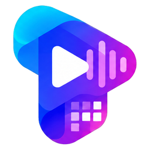
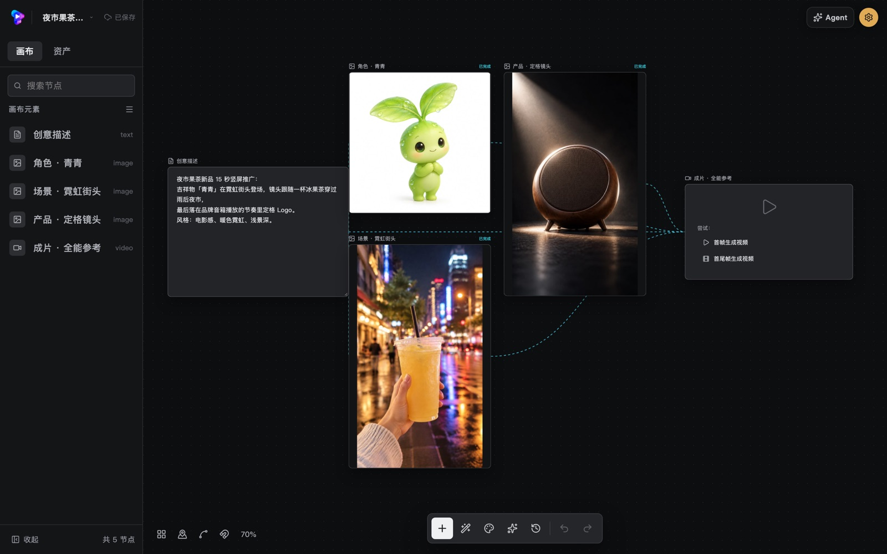
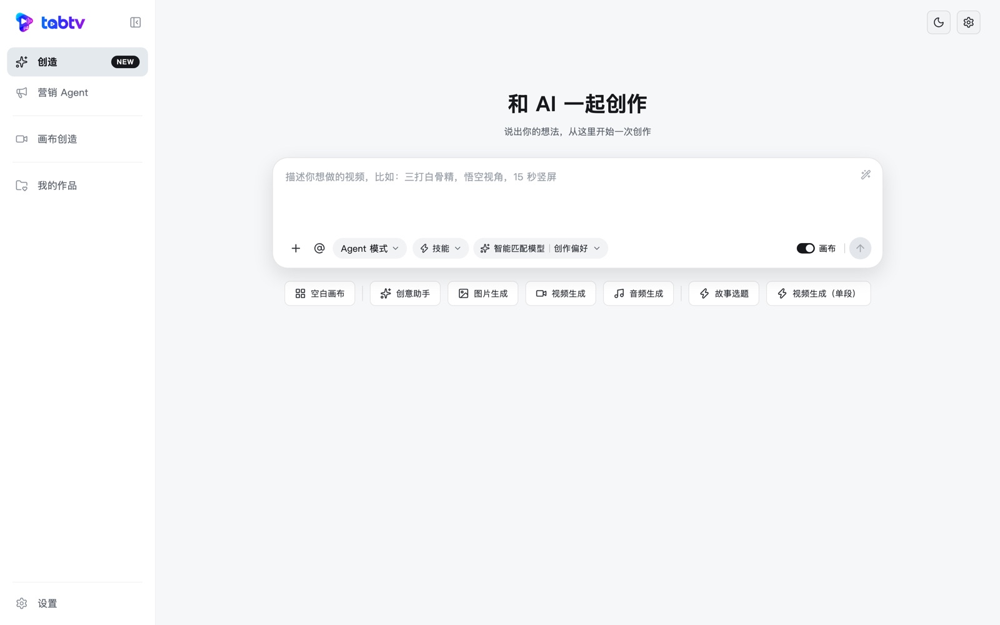
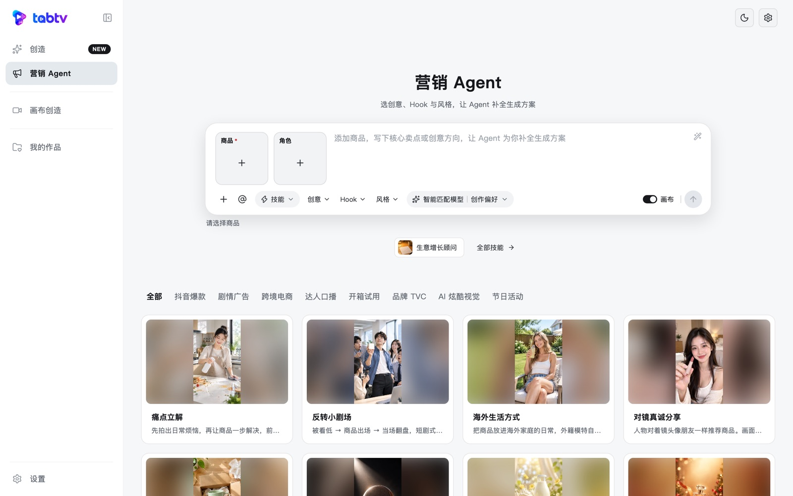
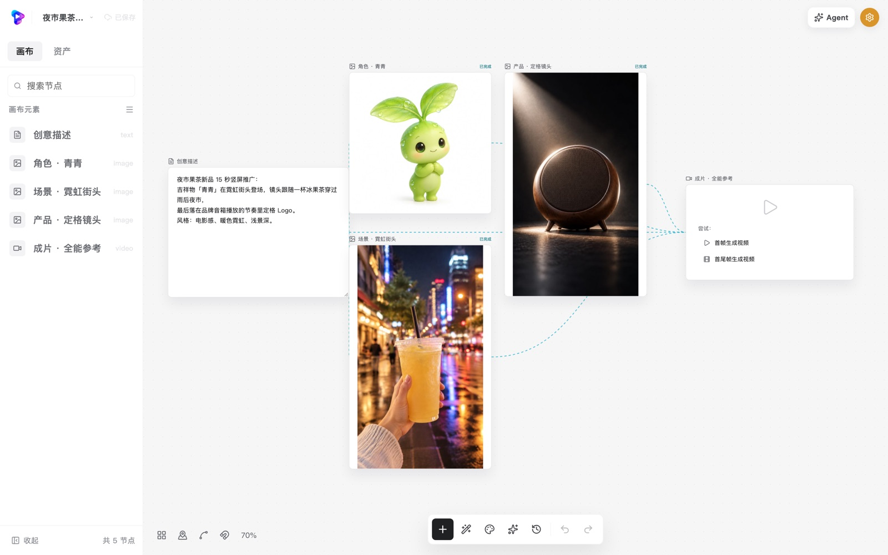
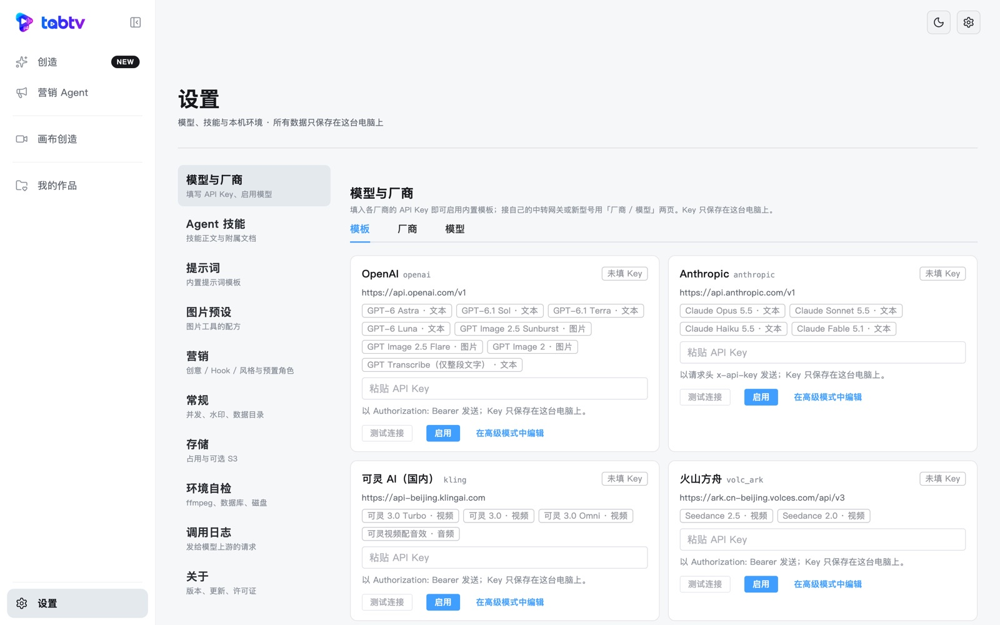

<p align="center">
  
</p>

<h1 align="center">tabtv</h1>

<p align="center">
  An open-source AI video studio for your desktop · script → storyboard → character &amp; scene art → video → final cut, all on one node canvas
</p>

<p align="center">
  <a href="https://github.com/li904338203/tabtv/releases/latest"></a>
  <a href="LICENSE"></a>
  
  <a href="https://github.com/li904338203/tabtv/actions/workflows/ci.yml"></a>
</p>

<p align="center">
  <a href="README.md">中文</a> · <b>English</b>
</p>

tabtv connects text, image, video and audio nodes on a canvas and drives the models **you** configure, taking a story all the way from script to finished film.

<p align="center">
  
</p>

- **Local-first**: one window, one process; the database and all media live on your machine. It only goes online to call your models and check for updates.
- **No account**: no sign-up, no credits, no pricing — you pay the model providers directly.
- **Bring your own keys**: enter each provider's API key in Settings; keys stay in the local database.

## Features

- **Node canvas**: wire text / image / video / audio nodes freely and run the whole graph in one click (parallel where possible, unchanged results are reused).
- **Agent**: plan and generate through conversation, including a marketing mode (product library, characters, batch variants).
- **Script storyboards**: script → shots → character / scene / prop sheets → per-shot prompts → batch images and videos.
- **Timeline &amp; rendering**: trim, transitions, subtitles, auto-assembly from storyboards; renders locally with the bundled ffmpeg (hardware H.264 encoders first).
- **Smart cut &amp; 3D director**: automatic rough cuts; pose mannequins and set camera angles in 3D.
- **Image tools**: character sheets, relighting, upscaling, multi-angle, inpainting, background removal, grid splitting and more.
- **Project export / import**: pack a project as a zip and restore it on another machine (no keys inside).
- **Auto update**: in-app download and install on Windows and Linux (AppImage); on macOS it points you to the download page.

## Screenshots

| Create with AI | Marketing agent |
| --- | --- |
|  |  |
| **Node canvas (light)** | **Models &amp; providers: paste a key and go** |
|  |  |

*The UI is currently in Chinese; an i18n framework is planned.*

## Download &amp; install

Latest: **[v0.1.0](https://github.com/li904338203/tabtv/releases/tag/v0.1.0)** (all versions on [Releases](https://github.com/li904338203/tabtv/releases))

| Platform | Download |
| --- | --- |
| macOS · Apple silicon | [tabtv-0.1.0-darwin-arm64.dmg](https://github.com/li904338203/tabtv/releases/download/v0.1.0/tabtv-0.1.0-darwin-arm64.dmg) |
| macOS · Intel | [tabtv-0.1.0-darwin-amd64.dmg](https://github.com/li904338203/tabtv/releases/download/v0.1.0/tabtv-0.1.0-darwin-amd64.dmg) |
| Windows 10/11 · 64-bit | [tabtv-0.1.0-windows-amd64-setup.exe](https://github.com/li904338203/tabtv/releases/download/v0.1.0/tabtv-0.1.0-windows-amd64-setup.exe) |
| Linux · x86_64 | [AppImage](https://github.com/li904338203/tabtv/releases/download/v0.1.0/tabtv-0.1.0-linux-amd64.AppImage) · [deb](https://github.com/li904338203/tabtv/releases/download/v0.1.0/tabtv_0.1.0_amd64.deb) |

Checksums: [SHA256SUMS](https://github.com/li904338203/tabtv/releases/download/v0.1.0/SHA256SUMS). Packages are about 110–135 MB and already include the database, ffmpeg and fonts — nothing else to install.

The builds are **not code-signed**, so the OS will warn you the first time:

- **macOS (12+)**: drag `tabtv.app` into Applications, then **right-click → Open → Open**. If it says the app is damaged, run `xattr -dr com.apple.quarantine /Applications/tabtv.app`.
- **Windows (10 / 11)**: on the SmartScreen prompt, click **More info → Run anyway**. WebView2 ships with Windows 11; on Windows 10 the installer guides you if it is missing.
- **Linux (x86_64, glibc 2.31+)**: `chmod +x tabtv-*.AppImage && ./tabtv-*.AppImage`. The UI uses the system WebKitGTK 4.0. **Playing H.264 video also needs GStreamer's libav plugin** — without it video areas stay black (the files themselves are fine):

| Distro | Command |
| --- | --- |
| Debian / Ubuntu | `sudo apt install gstreamer1.0-libav gstreamer1.0-plugins-good` |
| Fedora | `sudo dnf install gstreamer1-libav` (enable RPM Fusion first) |
| Arch | `sudo pacman -S gst-libav` |

## First run: set up a model

1. Open **Settings → Models &amp; Providers** (设置 → 模型与厂商) in the left sidebar.
2. Under **Templates** (模板), pick a provider, paste your API key → **Test connection** (测试连接) → **Enable** (启用). Template URLs are the providers' official endpoints; everything starts disabled.
3. Go back to the canvas and generate.

Built-in templates: OpenAI (GPT, GPT Image), Anthropic (Claude), Kling, Volcengine Ark (Seedance), Volcengine speech recognition &amp; MediaKit, xAI (Grok video), ElevenLabs (music).

**Using your own gateway / relay**: add a provider (gateway URL and key) under **Providers** (厂商), then add a model under **Models** (模型) and pick its API protocol — the request paths are filled in for you. Turn on **Enabled** when creating it and the app binds sensible default operations and input rules from the built-in templates; for existing models use **Recommended setup** (一键推荐配置) in *Operations &amp; parameters* (操作与参数).

| API protocol | Used for |
| --- | --- |
| OpenAI Chat / Anthropic Messages | text, agent reasoning, storyboards and prompts |
| OpenAI Images | text-to-image, image-to-image, asset sheets |
| OpenAI Video (`/v1/videos`) | services compatible with the OpenAI video API: text / image / first-last frame / multi-reference / video-to-video |
| Grok video, Kling video, Seedance video | each vendor's video API |
| OpenAI TTS / transcription, Volcengine ASR, ElevenLabs music, … | audio |
| Generic sync / async | relays that speak this app's own request envelope |

**Upstreams that only accept public URLs** (e.g. reference images / videos over the OpenAI Video protocol): configure an S3-compatible bucket under **Settings → Storage** (设置 → 存储) (MinIO, Alibaba OSS, Tencent COS, Volcengine TOS, R2, AWS S3). Reference media is uploaded there and the upstream receives a short-lived signed URL; your library stays local.

Settings also cover agent skills, prompts, image presets, marketing options and characters, concurrency and logs, upstream request logs, and diagnostics (database, ffmpeg, H.264 encoder, fonts, Linux video decoder).

## Where your data lives

| Platform | Default location |
| --- | --- |
| macOS | `~/Library/Application Support/tabtv` |
| Windows | `%APPDATA%\tabtv` |
| Linux | `$XDG_DATA_HOME/tabtv` (defaults to `~/.local/share/tabtv`) |

It contains `pg/` (database), `media/` (assets and outputs), `logs/` and `backups/` (database backups taken before each upgrade). Open it from Settings → General, or point `TABTV_DATA_DIR` somewhere else.

⚠️ API keys are stored **in plain text** in the database. Clear them in Settings before sharing your data folder.

## Build from source

Requirements: Go 1.26 (from `go.mod`; an older Go downloads the toolchain automatically) · Node 20.20.0 (`.nvmrc`) · pnpm 10.32.1 · [Wails v2 CLI](https://wails.io/docs/gettingstarted/installation). Linux also needs `libgtk-3-dev libwebkit2gtk-4.0-dev`.

```bash
pnpm install --frozen-lockfile
make pg       # embedded PostgreSQL (verified against build/third_party.lock)
make fonts    # typesetting fonts (SHA-256 verified)

# desktop app, output in build/bin/
wails build                       # macOS / Windows
wails build -tags webkit2_40      # Linux: required, otherwise request bodies never reach the backend

# or build a full installer (database, ffmpeg and fonts included), output in build/dist/
make package
```

Releasing: push a `v*` tag and GitHub Actions packages all four platforms and uploads them as a draft release.

Checks before committing:

```bash
make check     # internal-info scan + format + lint + contract + typecheck + tests + build
make test-it   # database integration tests (embedded PostgreSQL, no docker)
make help      # all targets
```

See [CONTRIBUTING.md](CONTRIBUTING.md) before contributing (written in Chinese; issues and PRs in English are welcome).

## License

tabtv is released under the [Apache License 2.0](LICENSE).

Bundled third-party components (PostgreSQL, FFmpeg, fonts, the director's 3D mannequins and MediaPipe, …) and their licenses are listed in [NOTICE](NOTICE). The dependency license list is generated by `build/gen-licenses.sh`, which fails on any GPL / AGPL dependency.
