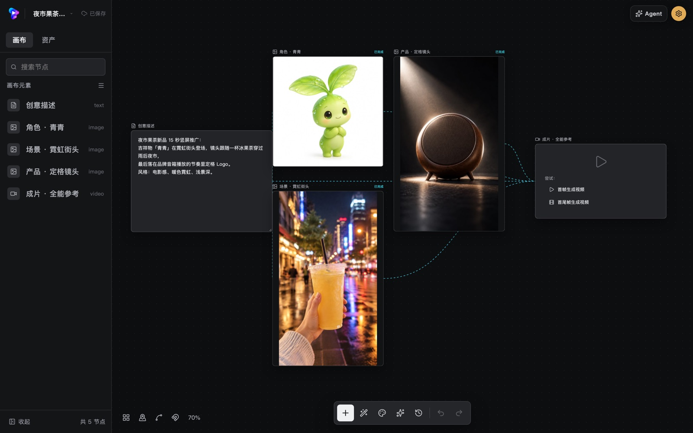
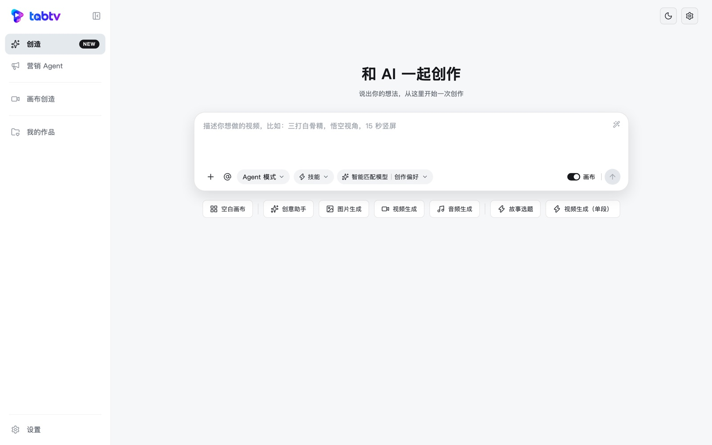
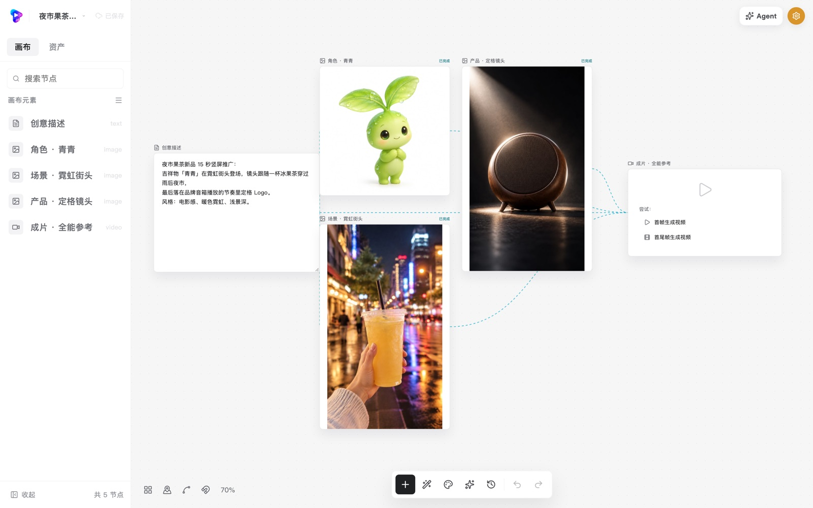
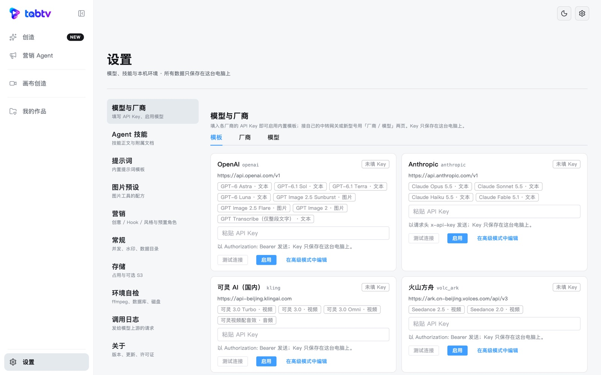

# tabtv

tabtv 是一个开源的 AI 视频创作桌面应用：在节点画布上把文本、图片、视频、音频串起来，调用你自己配置的模型完成从剧本到成片的整条流程。

<p align="center">
  
</p>

- **单机、离线可用**：一个窗口、一个进程，数据库与素材都在本机。只在调用模型和检查更新时联网。
- **没有账号**：不需要注册登录，也没有积分和计价 —— 模型费用由你和模型厂商直接结算。
- **自带 Key**：在设置里填写各厂商的 API Key，Key 只保存在本机数据库里。

## 功能

- **节点画布**：文本 / 图片 / 视频 / 音频节点自由连线，整图一键运行（自动并行、复用未变化的结果）。
- **Agent**：对话式规划与生成，含营销场景（商品库、角色库、批量变体）。
- **脚本分镜**：剧本 → 分镜 → 角色 / 场景 / 道具资产图 → 分镜提示词 → 批量出图出视频。
- **时间线与成片**：剪辑、转场、字幕、按分镜自动装配，用 ffmpeg 在本机渲染成片。
- **智能剪辑与导演台**：自动粗剪；3D 素模摆姿势、定机位。
- **图片工具**：设定图、打光、高清、多角度、涂抹重绘、抠图、宫格切分等。

## 截图

| 和 AI 一起创作 | 营销 Agent |
| --- | --- |
|  |  |
| **节点画布（浅色）** | **模型与厂商：填 Key 即用** |
|  |  |

## 下载与安装

安装包发布在本仓库的 [Releases](../../releases) 页面（macOS Apple 芯片 / Intel、Windows 64 位、Linux x86_64）。

安装包**没有做代码签名**，第一次打开时系统会拦一下，按下面的方法放行即可。

### macOS（12 及以上）

把 `tabtv.app` 拖进「应用程序」，然后**右键点击 → 打开 → 打开**。

如果提示「已损坏，无法打开」，在终端执行：

```bash
xattr -dr com.apple.quarantine /Applications/tabtv.app
```

### Windows（10 / 11，64 位）

运行安装程序时如果出现「Windows 已保护你的电脑」（SmartScreen），点 **更多信息 → 仍要运行**。

应用依赖 WebView2：Windows 11 已自带，Windows 10 缺失时安装程序会引导安装。

### Linux（x86_64，glibc 2.31+）

```bash
chmod +x tabtv-*.AppImage
./tabtv-*.AppImage
```

界面依赖系统的 WebKitGTK 4.0。**播放生成的 H.264 视频还需要 GStreamer 的 `gst-libav` 插件**，缺少时视频区域是黑的（产物本身没有问题）：

| 发行版 | 命令 |
| --- | --- |
| Debian / Ubuntu | `sudo apt install gstreamer1.0-libav gstreamer1.0-plugins-good` |
| Fedora | `sudo dnf install gstreamer1-libav`（需先启用 RPM Fusion） |
| Arch | `sudo pacman -S gst-libav` |

## 第一次使用：配置模型

1. 打开左侧栏的 **设置 → 模型与厂商**。
2. 应用内置了常见厂商的模板（地址都是厂商官方地址，默认全部停用）。选一个厂商，填入你的 API Key。
3. 启用要用的模型，回到画布即可生成。

设置页里还有：Agent 技能、提示词、图片预设、营销选项与角色、可选的 S3 兼容存储、并发与日志、环境自检（ffmpeg、字体、数据库）。

## 数据保存在哪里

| 平台 | 默认位置 |
| --- | --- |
| macOS | `~/Library/Application Support/tabtv` |
| Windows | `%APPDATA%\tabtv` |
| Linux | `$XDG_DATA_HOME/tabtv`（未设置时为 `~/.local/share/tabtv`） |

目录里有 `pg/`（数据库）、`media/`（素材与产物）、`logs/`（日志）、`backups/`（升级迁移前的数据库备份）。设置 → 常规里可以直接打开这个目录；也可以用环境变量 `TABTV_DATA_DIR` 指定别的位置。

⚠️ 数据库里**明文保存**你填写的 API Key。把数据目录发给别人之前，请先在设置里清掉 Key。

## 从源码构建

环境要求：Go 1.26（`go.mod` 指定；本机 Go 较旧时会自动下载对应工具链）· Node 20.20.0（见 `.nvmrc`）· pnpm 10.32.1 · [Wails v2 CLI](https://wails.io/docs/gettingstarted/installation)。Linux 另需 `libgtk-3-dev libwebkit2gtk-4.0-dev`。

```bash
pnpm install --frozen-lockfile
make pg       # 下载内嵌 PostgreSQL（按 build/third_party.lock 校验）
make fonts    # 下载排版字体（按 SHA-256 校验）

# 构建桌面应用，产物在 build/bin/
wails build                       # macOS / Windows
wails build -tags webkit2_40      # Linux：必须带这个标签，否则请求体传不到后端
```

开发与提交前的门禁：

```bash
make check     # 内部信息扫描 + 格式 + lint + 契约一致 + 类型检查 + 测试 + 构建
make test-it   # 数据库集成测试（用内嵌 PostgreSQL，不需要 docker）
make help      # 全部命令
```

参与开发请先读 [CONTRIBUTING.md](CONTRIBUTING.md)。

## 许可证

tabtv 以 [Apache License 2.0](LICENSE) 发布。

随包分发的第三方组件（PostgreSQL、FFmpeg、字体、导演台 3D 素模与 MediaPipe 等）及其许可证见 [NOTICE](NOTICE)；依赖库的许可清单由 `build/gen-licenses.sh` 生成（出现 GPL / AGPL 依赖即失败）。
